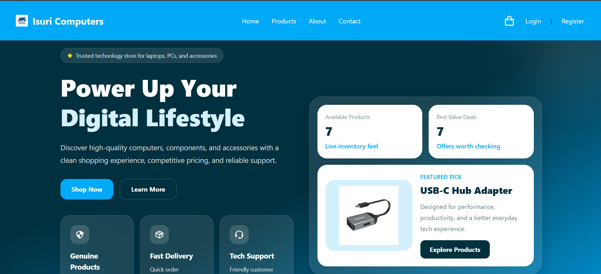
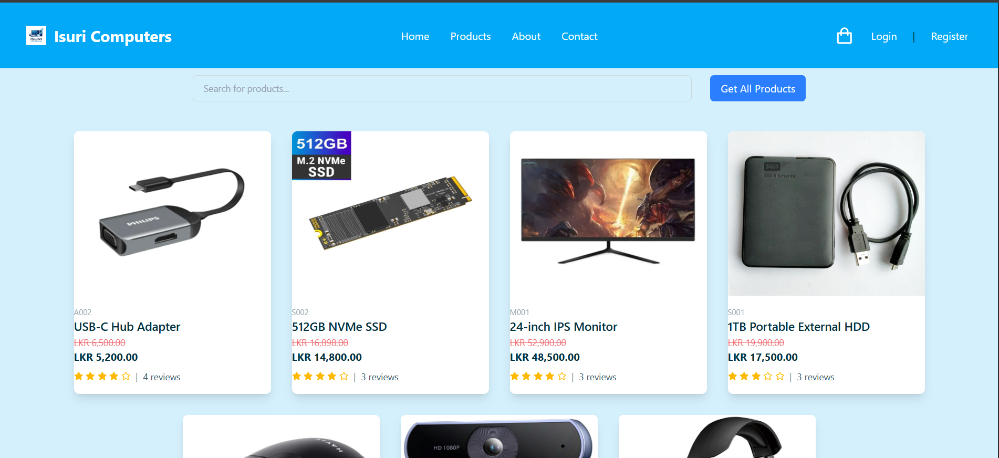
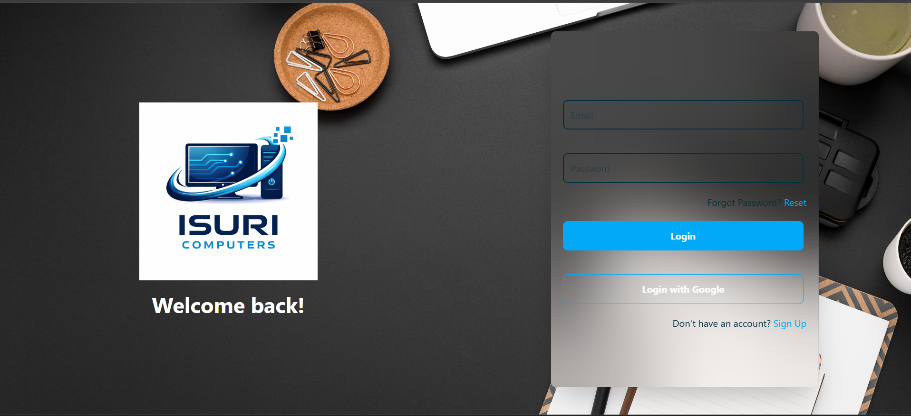
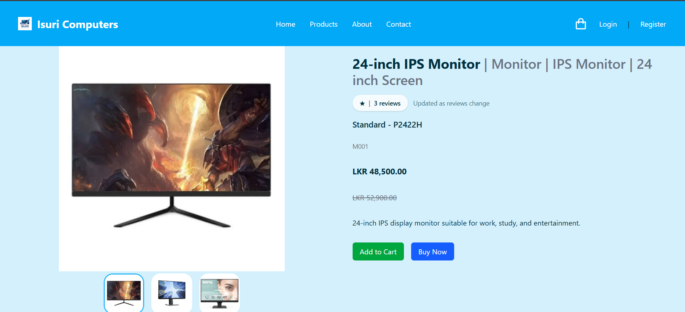
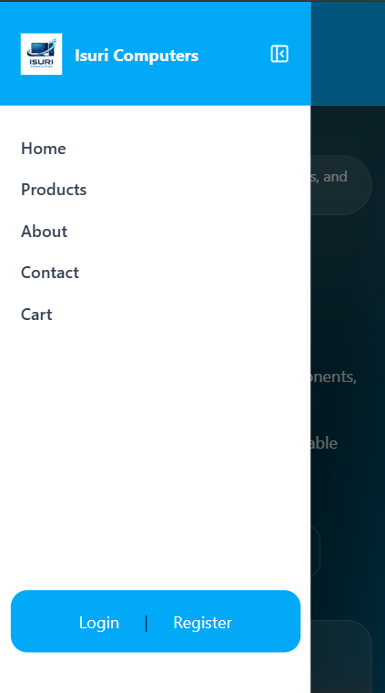

### I Computers – MERN Stack E-Commerce Web Application

Developed a full-stack e-commerce web application for a computer shop using the MERN technology stack. The platform provides separate login functionalities for administrators and customers, supporting product management and online shopping.

**Key Contributions & Features:**
- Developed the frontend and backend using React.js, Node.js, Express.js, and MongoDB with Mongoose.
- Implemented separate authentication and login functionality for administrators and customers.
- Developed an admin management system that allows administrators to add, update, and remove products, as well as manage users.
- Created customer-facing features that allow users to browse the product catalogue and purchase products.
- Implemented CRUD operations for efficient product and user management.
- Worked with RESTful APIs and database operations to connect the frontend and backend.

**Technologies Used:** MongoDB, Express.js, React.js, Node.js, Mongoose.

**Backend Repository:** https://github.com/ChamodyaWijerathne/i_computers_backend

**Live Demo**
[Visit Website](https://i-computers-frontend-alpha.vercel.app/)

## Screenshots

### Homepage

### Browse Products

### Login Page

### Product Overview

### Mobile View
